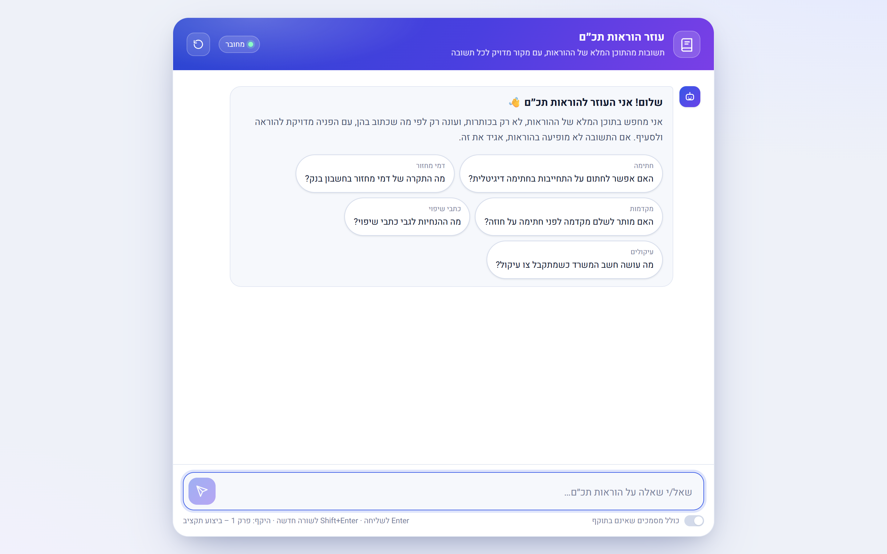
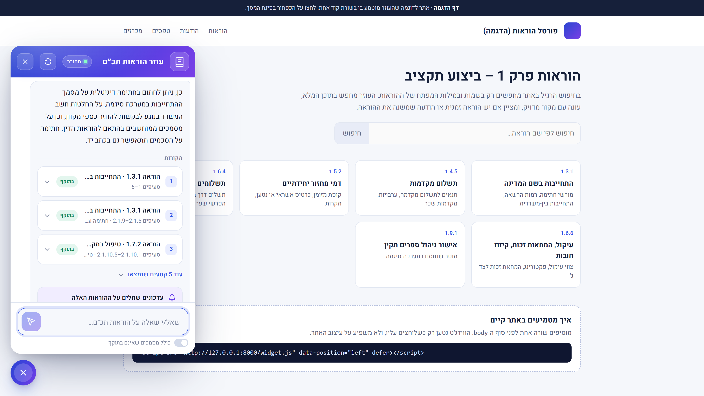

# חיפוש ושאלות בתוכן הוראות תכ"ם (POC)

שאלות-תשובות וחיפוש על **התוכן המלא** של הוראות תכ"ם ([takam.mof.gov.il](https://takam.mof.gov.il/)). כל תשובה כוללת ציטוט מקור (הוראה, סעיף וקישור לאתר), ולצידה מוצגות ההודעות וההוראות הזמניות התקפות שמשנות את ההוראה.

היקף ה-POC: פרק 1, "ביצוע תקציב". הוא כולל 34 הוראות, ועוד 10 הודעות והוראות זמניות שתלויות בהן.



| הבוט מוטמע באתר ועונה עם מקורות | וידג'ט במצב כהה |
|---|---|
|  |  |

---

## 1. הבעיה

תוכן ההוראות **לא מוצג באתר**. כל הוראה זמינה רק כקובץ Word להורדה. החיפוש באתר רץ בצד הלקוח (`filterByFreeTxt` → `multiSearchAnd` ב-`main.*.js`) ובודק רק את השדות `name`, `description`, `keywords` ו-`documentcodetext`. ההתאמה היא substring, וכל מילות השאילתה חייבות להופיע **באותו שדה**.

ההשלכות:

| שאילתה | באתר | בפועל |
|---|---|---|
| "חתימה דיגיטלית" | 0 תוצאות | הוראה 1.3.1 סעיף 2.1.5: "מסמך ההתחייבות במערכת סיגמה ייחתם באמצעות חתימה דיגיטלית" |
| "עבירת משמעת" | 0 תוצאות | הוראה 1.3.1, פרק שלם (2.5) |
| "רכב" | 95 תוצאות | substring: גם "מורכב" ו"הרכב" |

**הבעיה לא מסתכמת במציאת ההוראה. צריך לדעת גם מה תקף עכשיו.** הוראה 1.3.3 ("כתבי שיפוי") היא קובץ של 111 תווים שכל תוכנו הפניה להוראה הזמנית HZ.1.3.3.1. להוראות אחרות יש הודעות והוראות זמניות שחלקן פגו, כמו HZ.1.6.2.1 שפגה ב-5.2.2025. במטא-דאטה של המסמכים האלה אין מספר פרק, והם מקושרים רק דרך `parentdocument`. גם השדה `isvalid` לא אמין: ערכו `false` בכל 418 ההוראות.

**מי מושפע:** חשבים, סגני חשבים, ואנשי רכש ותקציב במשרדי הממשלה וביחידות הסמך. ההוראות מחייבות, ולכן פספוס הוא סיכון לפעולה בניגוד להנחיות, או עוד פנייה לאגף החשב הכללי.

כשהנושא מופיע בשם ההוראה או במילות המפתח שלה, האתר כן מוצא אותה (למשל "מורשי חתימה"). הפער הוא בכל מה שנמצא רק בגוף הטקסט.

## 2. הפתרון

1. **Ingestion:** משיכת מטא-דאטה מה-API הציבורי, בחירת המהדורה התקפה, הורדת ה-DOCX ופירוק למבנה של סעיפים וטבלאות.
2. **חיפוש:** SQLite FTS5 עם BM25 ונרמול עברית: גרשיים, ותחיליות כחלופה.
3. **תשובה עם ציטוטים (אופציונלי):** LLM עונה **רק** מהקטעים שנשלפו ומחזיר מזהי קטעים. השרת מוודא שכל ציטוט מצביע על קטע שנשלף. בלי ציטוט תקף התשובה לא מוצגת.
4. **תוקף:** מסמכים שפג תוקפם מוסתרים כברירת מחדל, ולכל הוראה מוצגות ההודעות וההוראות הזמניות התקפות שלה.
5. **מצב ללא AI:** בלי מפתח, או כשה-LLM נכשל, המערכת ממשיכה לעבוד כמנוע חיפוש.

```
takam.mof.gov.il API ──► takam-ingest fetch ──► data/raw/ (manifest.json + DOCX)   ← מדגם שמור ב-repo
                                                     │
                                  takam-ingest build ▼   (offline, דטרמיניסטי, החלפה אטומית)
                                              data/index.db (SQLite: docs, chunks, FTS5)
                                                     │
                     FastAPI ── GET /search  ── Retriever (BM25 + תוקף + מסמכים קשורים)
                             ── POST /ask    ── Answerer (ניסוח-מחדש → שליפה → LLM → אימות ציטוטים)
                             ── GET /health  ── readiness
                             ── GET /        ── צ'אטבוט (RTL)
                             ── GET /widget.js ── וידג'ט להטמעה בכל אתר (שורת קוד אחת)
                             ── GET /demo    ── דף לדוגמה עם הווידג'ט מוטמע
```

## 3. הרצה

דרישות: Python 3.11 ומעלה. אין צורך בגישה לאתר: מדגם הנתונים נמצא ב-`data/raw`.

**התקנה:**

```bash
git clone https://github.com/MichalGlus/takam-search-bot.git
cd takam-search-bot

python -m venv .venv
# Windows: .venv\Scripts\activate    |  Linux/macOS: source .venv/bin/activate

pip install -e ".[gemini,dev]"
# לחלופין: pip install -r requirements.txt && pip install -e . --no-deps
```

**הגדרת משתני סביבה:** יש להעתיק את הקובץ `.env.example` לקובץ חדש בשם `.env` ולמלא בו את הערכים. הקובץ `.env` מוחרג ב-`.gitignore` ואין להעלות אותו ל-Git.

```bash
cp .env.example .env        # Windows (PowerShell): Copy-Item .env.example .env
```

| משתנה | תיאור | ברירת מחדל |
|---|---|---|
| `TAKAM_LLM_API_KEY` | **סודי.** מפתח API של ספק ה-LLM. בלעדיו השירות עובד במצב חיפוש בלבד | ריק |
| `TAKAM_LLM_PROVIDER` | ספק LangChain (`google_genai`, `anthropic`, `openai`...) | `google_genai` |
| `TAKAM_LLM_MODEL` | שם המודל הראשי | `gemini-3.5-flash` |
| `TAKAM_LLM_FALLBACK_MODEL` | מודל גיבוי קל יותר כשהראשי נכשל. ריק = ללא גיבוי | `gemini-3.5-flash-lite` |
| `TAKAM_LLM_ENABLED` | `false` כופה מצב חיפוש בלבד גם כשיש מפתח | `true` |
| `TAKAM_LLM_TIMEOUT` | זמן המתנה מרבי לתשובת ה-LLM (שניות) | `25` |
| `TAKAM_BASE_URL` | כתובת אתר המקור (משמש רק את `takam-ingest fetch`) | `https://takam.mof.gov.il/` |
| `TAKAM_CHAPTERS` | פרקים להורדה מהאתר | `[1]` |
| `TAKAM_REQUEST_DELAY` | השהיה בין בקשות לאתר (שניות) | `0.5` |
| `TAKAM_REQUEST_TIMEOUT` | timeout לבקשה לאתר (שניות) | `60` |
| `TAKAM_MAX_RETRIES` | מספר ניסיונות חוזרים בבקשה שנכשלה | `3` |
| `TAKAM_SEARCH_TOP_K` | מספר הקטעים שהשליפה מחזירה | `8` |
| `TAKAM_DATA_DIR` | תיקיית הנתונים והאינדקס (אופציונלי) | `./data` |

ברירת המחדל היא Gemini. כל ספק שנתמך ב-LangChain `init_chat_model` יעבוד: מתקינים את החבילה שלו (`.[anthropic]`, `.[openai]`) ומשנים את `TAKAM_LLM_PROVIDER` ו-`TAKAM_LLM_MODEL`.

**הרצה:**

```bash
uvicorn takam_search.api:app --port 8000      # בונה את האינדקס בהפעלה הראשונה (כ-15 שניות)
# http://127.0.0.1:8000        הצ'אטבוט
# http://127.0.0.1:8000/demo   אתר לדוגמה עם הבוט מוטמע (כפתור בפינה)
```

פקודות נוספות:

```bash
pytest -q                          # 86 בדיקות, 1-3 דקות
takam-eval --k 5 --min-recall 0.9  # הערכת איכות השליפה + השוואה לחיפוש באתר
takam-ingest fetch                 # רענון המדגם מהאתר (כ-1.5 דקות, 0.5 שניות בין בקשות)
takam-ingest build                 # בניית האינדקס מחדש מ-data/raw
docker build -t takam-search . && docker run -p 8000:8000 --env-file .env takam-search
```

ב-Windows: אם עברית מופיעה משובשת בטרמינל, מגדירים `PYTHONIOENCODING=utf-8`.

## 4. בדיקות והערכה

**86 בדיקות** (pytest), מאורגנות לפי מודול:

- **parser:** מספור סעיפים מחושב מ-numbering.xml, כולל ירושת `numId` מסגנון הבסיס ופסקה עם `numId=0`. טבלאות נשמרות לפי הסדר, "טבלת שינויים" נשמרת כמטא-דאטה, ויש בדיקות למסמך בלי סגנונות (H.1.1.1), למסמך-הפניה קצר (H.1.3.3), לקובץ ריק או פגום, ולפיצול פסקה ארוכה עם חפיפה.
- **hebrew:** וריאנטים של גרשיים, תחיליות, מילים קצרות שלא נחתכות, ניקוד, מילות עצירה, ואופרטורים של FTS5 בקלט המשתמש.
- **retriever:** שאילתות זהב, תשובה ששורה בטבלה מכילה (רמת אישור 3 = 43,000), הסתרה של מסמכים שפג תוקפם, שאילתה ריקה, ארוכה מאוד או בלי התאמה.
- **answerer:** ציטוט לא קיים נדחה. בלי ציטוט תקף התשובה לא מוצגת. בודקים גם תשובת "לא נמצא", כשל של ה-LLM, כשל בניסוח מחדש, ואת ה-adapter של LangChain.
- **client / ingest:** retry עם backoff, timeout, 404 בלי retry, תשובה 200 שאינה DOCX, ומסמך בלי מהדורה להורדה. **בנייה שמאבדת מעל 50% מהקטעים נכשלת, והאינדקס הקודם נשאר.**
- **api:** health/search/ask, ולידציה, מצב חיפוש בלבד, 503 כשאין אינדקס, ובניית האינדקס בהפעלה.

**הערכת שליפה** (`data/eval.jsonl`, 22 שאילתות מילות-מפתח):

| | המסמך הצפוי נמצא |
|---|---|
| POC: recall@5 | **22/22** (MRR 0.95) |
| חיפוש האתר (אותה לוגיקה, אותם מסמכים, בלי דירוג) | 8/22 |

סייג: את השאילתות כתבתי אחרי שקראתי את התוכן, ולכן הסט מוטה לטובת המערכת. הוא משמש בעיקר כבדיקת רגרסיה (שער ב-CI), ולא כמדד איכות מוחלט. סט אמיתי צריך לבוא משאלות של משתמשים.

## 5. החלטות הנדסיות

| החלטה | למה | מה ויתרתי עליו |
|---|---|---|
| **SQLite FTS5 בלי embeddings** | קובץ אחד, בלי תשתית ובלי מודל להוריד. בקורפוס של כ-200 אלף תווים, BM25 עם נרמול עברית הגיע ל-22/22 בסט ההערכה. | חיפוש לפי משמעות. הפיצוי החלקי הוא ניסוח מחדש של השאלה ע"י ה-LLM (עד 3 ניסוחים, מאוחדים ב-RRF). חמש התוצאות הראשונות של השאלה המקורית נשמרות תמיד, אחרי שניסוח מחדש עם מונח שלא קיים בהוראות דחק החוצה את הסעיף הנכון. |
| **תחיליות כחלופה ב-OR, לא חיתוך** | חיתוך לפי כללים הורס מילים כמו "משרד"→"שרד". הצורות בלי התחילית נשמרות בעמודה נפרדת עם משקל נמוך (0.4), כך שהתאמה מדויקת עדיין מדורגת גבוה. | מורפולוגיה מלאה (שורשים, נטיות). |
| **מיזוג BM25 עם חיפוש ביטויים (RRF)** | בשאלה "האם אפשר לחתום בחתימה דיגיטלית?" המילים הנפוצות דחקו את סעיף 2.1.5 למקום השביעי. חיפוש ביטויים לבדו העדיף ביטוי כללי ("חשבון בנק") על התשובה. המיזוג מתגמל קטע שמדורג גבוה בשני החיפושים. שני המקרים נשמרו כבדיקות רגרסיה. | – |
| **מודל גיבוי** (`TAKAM_LLM_FALLBACK_MODEL`) | בבדיקה, מודלי Gemini החזירו לסירוגין 503 ("high demand") ו-504. מודל קל יותר של אותו ספק ענה. timeout של 25 שניות ו-retry אחד, כדי שהמשתמש לא יחכה דקות. | איכות מעט נמוכה יותר בזמן גיבוי. |
| **OR בין מילות השאילתה** | משתמשים כותבים שאלות ולא מילות מפתח. BM25 מדרג גבוה קטעים עם יותר מילים, ומילים נדירות יותר. | דיוק בשאילתות של מילה אחת נפוצה. |
| **מספור סעיפים מחושב מ-numbering.xml** | המספרים לא קיימים בטקסט, וציטוט בלי מספר סעיף הוא ציטוט חלש. | הרינדור של Word מורכב יותר. המספור הוא best-effort (ראה מגבלות). |
| **תוקף מתאריכים, לא מ-`isvalid`** | השדה לא אמין (false לכל ההוראות). | – |
| **ציטוטים מאומתים בצד השרת** | ה-LLM מחזיר מזהי קטעים במבנה מוגדר (structured output). מזהה שלא נשלף נמחק, ותשובה בלי אף ציטוט תקף לא מוצגת. | תשובות "חכמות" שאין להן מקור. |
| **LangChain `init_chat_model`** | בחירת ספק ומודל בקונפיגורציה בלבד. ברירת המחדל היא Gemini. | תלות כבדה יחסית לעומת SDK ישיר. |
| **fetch ו-build כשלבים נפרדים** | build רץ offline ודטרמיניסטי, ולכן אפשר לבדוק ולשחזר אותו. כשל ב-fetch לא נוגע באינדקס. | – |
| **בנייה לקובץ זמני והחלפה אטומית עם בדיקת שפיות** | שינוי במבנה של האתר או של ה-DOCX לא מחליף אינדקס תקין באינדקס חלקי. | – |
| **מדגם הנתונים ב-repo (13MB)** | ההרצה, הבדיקות וה-CI לא תלויים בזמינות האתר. | גודל ה-repo. |

## 6. מגבלות ידועות ומה לא מומש

- **מספור סעיפים:** חושב לפי כללי המספור של Word (מספור לפי סגנון, ירושה, `numId=0`). ברוב ההוראות הוא נכון, אבל לא אומת מול רינדור של Word. ב-1.6.1 ו-1.10.2, למשל, יש רשימות שמתחילות מחדש, והמספרים שם עלולים להיות שגויים. לכן לצד המספר מוצג גם נתיב הכותרות.
- **סכומים בטבלאות עם כיווניות מעורבת:** כשטקסט עברי ומספרים מעורבבים, חלק מהסכומים יוצאים משובשים בגלל סדר ה-runs. למשל ב-1.3.1, רמה 7 מופיעה כ-"0,00015" במקום 150,000. כדי לתקן צריך לממש את אלגוריתם הדו-כיווניות (bidi).
- **תמונות ותרשימים** (למשל תרשים זרימה ב-1.9.1) לא מעובדים.
- **לא מומש:** כל הפרקים, טפסים וקבצים מצורפים, סנכרון אינקרמנטלי, השוואת מהדורות, אימות משתמשים, הערכה של איכות התשובות (רק השליפה נמדדת), והפיכת הפניות בין הוראות ("ראה הוראת תכ"ם 1.3.2") לקישורים.
- **ה-LLM נבדק אוטומטית רק עם mock.** מול Gemini (`gemini-3.5-flash`) נבדק ידנית: תשובות עם ציטוט נכון, "לא נמצא" לשאלה שאינה בתחום, וחזרה לחיפוש כשהספק עמוס (503) או כשהמפתח לא תקין. זמן תשובה כ-15–30 שניות, כי יש שתי קריאות ל-LLM (ניסוח מחדש ותשובה).

## 7. תחזוקתיות וסקיילביליות: מה הייתי משפר

1. **סט הערכה אמיתי** משאלות של חשבים, כולל הערכה של התשובות עצמן ולא רק של השליפה. כל שינוי בדירוג או במודל נמדד מולו.
2. **חיפוש סמנטי** (embeddings רב-לשוניים) כרכיב שנכנס רק אם הוא משפר את המדדים בסט ההערכה. בהיקף של כל האתר: Postgres עם pgvector או מנוע חיפוש ייעודי.
3. **ingestion אינקרמנטלי** לפי `contentversionid` ו-`rtn_validfrom__c`: מורידים ומפרסרים רק מהדורות שהשתנו. היום משיכה מלאה של פרק לוקחת כ-1.5 דקות. כל האתר (כ-1,100 מסמכים) ייקח בערך חצי שעה בקצב מנומס.
4. **טיפול ב-bidi ובתרשימים**, וכן חילוץ ההפניות בין הוראות לגרף קישורים.
5. **שכבת parser לכל "משפחת" מסמכים**, עם בדיקות snapshot על מדגם קבוע, כדי לזהות שינוי תבנית בקבצים.

## 8. פריסה ותפעול

**פריסה אוטומטית בארגון:**

- **CI** (`.github/workflows/ci.yml`): בדיקות, בניית אינדקס, ושער איכות `takam-eval --min-recall 0.9`. אחר כך build של image ו-**smoke test** מול הקונטיינר: `/health` מחזיר 200, ושאילתת זהב ("חתימה דיגיטלית") מחזירה את H.1.3.1. image שלא עבר את השלבים האלה לא מגיע לפריסה.
- **Image:** האינדקס נבנה בזמן ה-build, כך שכל image מכיל אינדקס מוכר ונבדק, והקונטיינר מתחיל לשרת מייד. הקונטיינר רץ כמשתמש שאינו root, עם `HEALTHCHECK`.
- **בארגון:** פריסה ל-Kubernetes או OpenShift מה-registry. `readinessProbe` ו-`livenessProbe` על `/health`, ו-rolling update שמחליף pod רק אחרי ש-readiness עובר.
- **רענון נתונים:** job מתוזמן, נפרד מהשירות (CronJob), שמריץ `takam-ingest fetch && takam-ingest build`, ואז בונה image חדש או מעלה את `index.db` לאחסון משותף. השירות עצמו לא ניגש לאתר.
- **סודות:** מפתח ה-LLM מגיע ממשתנה סביבה שמוזרק מ-Secret או vault, לא מהקוד ולא מה-image (`.env` מוחרג ב-`.gitignore` וב-`.dockerignore`).

**אימות שהפריסה תקינה:** `/health` מחזיר 503 כשהאינדקס חסר, פגום או ריק, ו-200 עם מספר המסמכים והקטעים, תאריך הבנייה, ואם ה-LLM פעיל. אחרי פריסה מריצים smoke test עם שאילתת זהב. כדאי לבדוק גם שמספר המסמכים והקטעים ב-`/health` תואם לבנייה האחרונה.

**ניטור:** כל בקשה נרשמת בלוג עם נתיב, סטטוס וזמן תגובה. כשלי LLM נרשמים כ-warning, ושיעור התשובות שמגיעות במצב `search_only` הוא מדד לבריאות ה-LLM. ב-ingest נרשמת שורה לכל מסמך, עם סיכום של מספר הכשלים ושל `failed_docs` ב-meta של האינדקס.

### תרחיש כשל: האתר משנה את מבנה ה-DOCX או ה-API

**מה קורה:** הורדות מחזירות דף HTML במקום DOCX, או שהקבצים מגיעים אבל ה-parser מחלץ מהם מעט טקסט.

**זיהוי:**
1. `client.download` מוודא שהקובץ מתחיל ב-`PK`. מסמך שנכשל נרשם ב-manifest עם `error`, וה-job מסתיים עם מספר הכשלים בלוג.
2. `takam-ingest build` משווה את מספר הקטעים לבנייה הקודמת. ירידה של יותר מ-50% מכשילה את הבנייה (`IndexBuildError`), **האינדקס הקיים ממשיך לשרת**, וה-job יוצא עם קוד 1. זה מה שמפעיל את ה-alert.
3. ב-meta של האינדקס נשמר `failed_docs`, וכדאי להתריע גם על עלייה בו.

**אבחון:**
1. בלוג של ה-job רואים אילו מסמכים נכשלו ומה הסיבה (`not a DOCX`, `parse failed`, `no text extracted`).
2. מריצים את ה-parser על הקובץ הבעייתי: `python -c "from takam_search.parser import parse_docx; print(parse_docx('data/raw/docs/H.1.3.1.docx').blocks[:5])"`.
3. משווים את ה-manifest החדש לקודם (שדות שנעלמו, `contentversionid` חסר), ומריצים `takam-eval` כדי לראות אם איכות השליפה ירדה.

**תיקון:** מעדכנים את ה-parser או ה-client, מוסיפים את הקובץ החדש כבדיקה, ומריצים את ה-pipeline. עד אז המשתמשים מקבלים את האינדקס התקין האחרון.

## 9. מבנה הקוד

```
src/takam_search/
  config.py      הגדרות (pydantic-settings, .env)
  client.py      קריאות ל-API של האתר: retry, timeout, אימות DOCX
  validity.py    תוקף ובחירת מהדורה לפי תאריכים
  parser.py      DOCX → בלוקים: מספור Word, טבלאות, כותרות, טבלת שינויים
  chunker.py     קיבוץ לקטעים לפי כותרת וגודל
  hebrew.py      נרמול, תחיליות, בניית שאילתת FTS5
  index.py       בניית SQLite + FTS5, בדיקות שפיות, החלפה אטומית
  retriever.py   BM25, סינון תוקף, מסמכים קשורים, RRF
  answerer.py    RAG: ניסוח מחדש, תשובה, אימות ציטוטים, adapter ל-LangChain
  ingest.py      CLI: fetch / build
  evaluate.py    recall@k והשוואה לחיפוש באתר
  api.py         FastAPI
web/index.html   צ'אטבוט: שלבי התקדמות, כרטיסי מקור, הדגשת מונחים, מצב כהה
web/widget.js    וידג'ט להטמעה: כפתור צף + iframe, נטען רק בלחיצה
web/demo.html    אתר לדוגמה עם הווידג'ט
data/raw/        מדגם: manifest.json + 44 קובצי DOCX
data/eval.jsonl  סט הערכה
tests/           86 בדיקות
.env.example     תבנית משתני סביבה (להעתיק ל-.env)
requirements.txt תלויות
```

## 10. שימוש ב-AI

את המחקר על האתר, הקוד והבדיקות פיתחתי בעזרת Claude Code. את הממצאים על האתר אימתתי מול ה-API וה-JS בפועל, ואת הקוד הרצתי ובדקתי על הנתונים האמיתיים.
